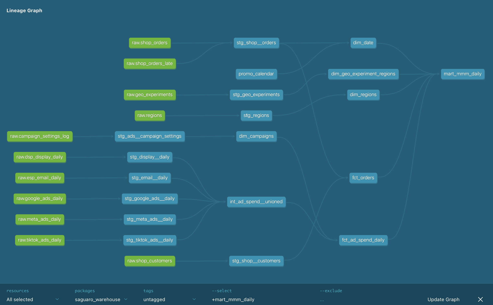
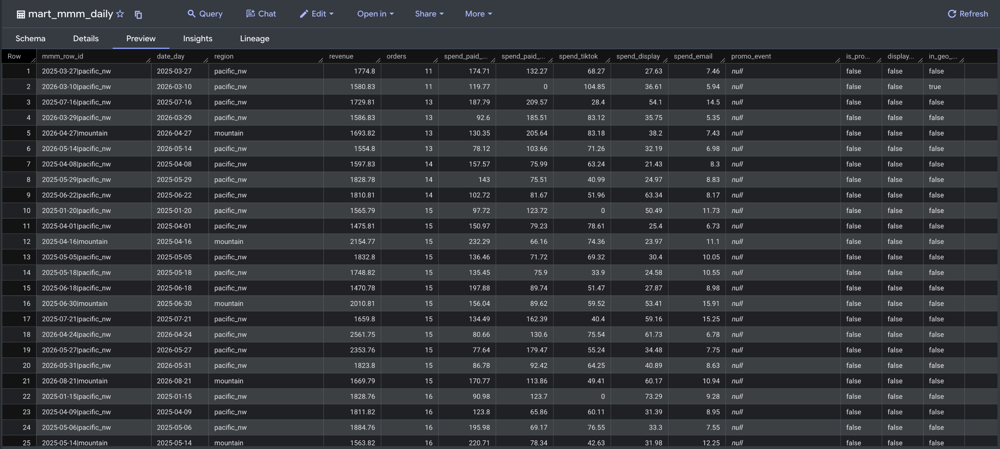
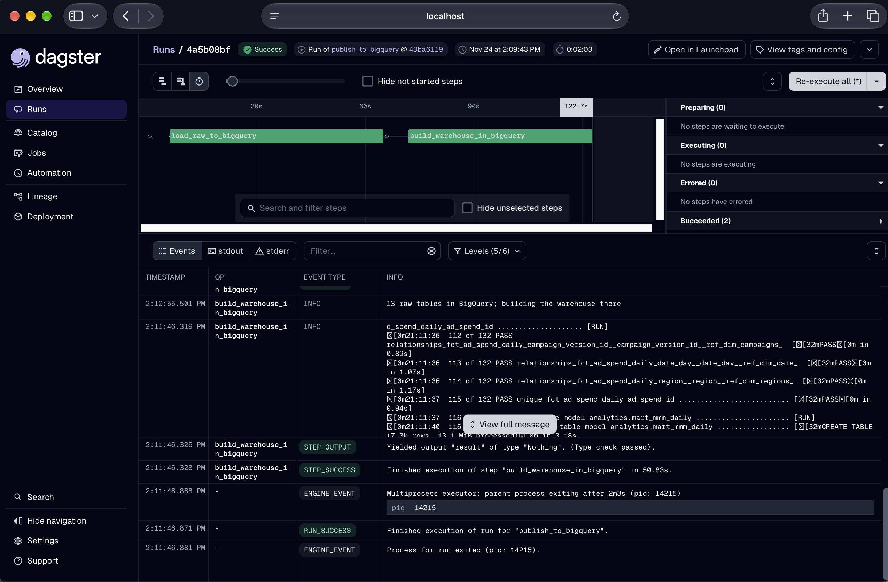

# Marketing Measurement Copilot

**Which ad dollars actually drive sales?** Every ad platform claims credit for the same purchases, so online brands
overestimate what their ads do and put budget in the wrong places. This project is a prototype that estimates the
true return on each channel, recommends budget shifts, and answers questions in plain English, with every number
coming from a statistical model rather than an LLM.

> **Status: Week 5 of 11.** Data foundation done (simulator, dbt on DuckDB and BigQuery, Dagster). Measurement:
> Bayesian MMMs graded against the truth, a geo experiment analysis, and CUPED on a real 14M-user test.
> Next: the budget optimizer.

## Why simulated data?

Real companies never know the true effect of their ads, which makes it impossible to check whether a measurement
model is right. So this project starts from a simulated brand, **Saguaro Supply Co.** (fictional), whose true
channel effects are known. The models never see that truth; tests and results compare against it.
Public real-world data (the Criteo uplift dataset) is used for the A/B-testing module.

## What the simulator produces

Two years (Oct 2024 to Sep 2026) of daily data across 10 US regions and 5 channels, about 320,000 orders and
57,000 ad-platform rows, exported the way a brand really receives them:

| File | Source it imitates | Built-in quirk |
| --- | --- | --- |
| `google_ads_daily.csv` | Google Ads | Campaign names with inconsistent casing and spaces |
| `meta_ads_daily.csv` | Meta Ads | Duplicate rows, missing impression counts |
| `tiktok_ads_daily.csv` | TikTok Ads | Spend stored as text, e.g. `$1,234.56` |
| `dsp_display_daily.csv` | Display DSP | UTC end-of-day timestamps (naive date cast is off by one day); missing days |
| `esp_email_daily.csv` | Email platform | Emails sent instead of impressions |
| `shop_orders.csv`, `shop_orders_late.csv` | Store backend | Some recent orders arrive in a later export |
| `shop_customers.csv`, `shop_products.csv`, `shop_price_history.csv` | Store backend | Prices change over time |
| `campaign_settings_log.csv` | Ad platforms' change history | Budgets, names and targeting change (feeds an SCD Type 2) |
| `geo_experiments.csv` | Brand's test log | A 4-week paid-social geo holdout |

Each quirk can be switched off in `simulator/config.yaml`, and the tests prove each one changes only its own file.

### How sales are generated

Each day's expected orders in each region are baseline demand (trend, weekly and yearly seasonality, holidays)
plus each channel's effect. A channel's effect carries over from day to day (**adstock**) and shows diminishing
returns (**saturation**, a Hill curve). Actual orders are Poisson draws around that expectation.

Ad platforms report conversions the way real ones do: inflated by view-through credit and by claiming purchases
that would have happened anyway.

### The truth the models must recover

| Channel | True iROAS | ROAS the platform reports | True marginal iROAS |
| --- | --- | --- | --- |
| Paid search | 2.00 | 3.48 | 1.08 |
| Paid social | 2.40 | 4.22 | 1.42 |
| TikTok | 0.80 | 1.98 | 0.36 |
| Display | 0.50 | 2.84 | 0.20 |
| Email | 7.00 | 16.75 | 4.15 |

On the platforms' own numbers every channel looks profitable. In truth, TikTok and display lose money, and the next
dollar in paid search earns far less than the average dollar. The geo holdout's true incremental ROAS is 2.44.

**Terms used here:** *incremental ROAS (iROAS)* is revenue the ads actually caused per $1 spent. *Platform ROAS* is revenue the ad platform claims per $1 spent. *Marginal iROAS* is what the next dollar earns.

Ground truth is written to `data/ground_truth/` and is never read by any model.

## Data warehouse (dbt)

The messy exports are cleaned and modeled with dbt into a tested star schema. Its final table,
`mart_mmm_daily`, is the single input the media mix model reads: one row per day and region with actual store
revenue and each channel's spend. Platform-reported conversions are deliberately left out of it.



| Layer | Models | What happens there |
| --- | --- | --- |
| Staging | 12 views, one per raw file | Rename columns, set types explicitly, fix each export's defect |
| Intermediate | `int_ad_spend__unioned` | All five ad platforms stacked into one shape |
| Marts | `fct_ad_spend_daily`, `fct_orders` | Facts: spend per day, campaign and region; every store order |
| Marts | `dim_campaigns` (SCD Type 2), `dim_date`, `dim_regions`, `dim_products`, `dim_geo_experiment_regions` | Dimensions; campaigns keep every version of their name, targeting and budget |
| Marts | `mart_mmm_daily` | Model input: 7,300 rows (730 days x 10 regions) |

**Key design decisions**

- **Raw columns are read as text and typed explicitly in staging,** so a bad value fails loudly instead of being guessed.
- **Duplicates are removed on the table's grain** (day, campaign, region), not with `distinct`, because platforms revise numbers after the fact.
- **Missing stays missing.** Blank impressions stay NULL, and display's skipped export days are flagged rather than filled with zero spend.
- **Joins use IDs, never names.** Spend links to the campaign version live that day, so names and settings come from the official change log.
- **The SCD Type 2 dimension is built from the platforms' change log** rather than a dbt snapshot, because the full history is already available.

**Data quality:** 110 tests run on every build: keys, relationships between tables, no negative money, exactly one
current version per campaign, and reconciliation tests proving the MMM table holds exactly the same spend and revenue
as the fact tables. One test is set to warn rather than fail: 80 Meta rows have blank impression counts.

## Cloud warehouse and orchestration

**BigQuery.** The same dbt models run locally on DuckDB (`dev`, free and fast) and on Google BigQuery
(`prod`). Where the two SQL dialects differ, for example `try_cast` vs `safe_cast` or how to list every day in
a range, the models call small cross-database macros (`warehouse/macros/cross_db.sql`) instead of keeping two
copies of each model. Both warehouses pass the same 132 checks and produce identical results:
7,300 rows and $40,705,705.40 of revenue in `mart_mmm_daily`.



**Dagster.** One pipeline replaces running commands by hand, in order:

- Each raw export file and each dbt model is a Dagster **asset**, so the full lineage is visible and every
  table shows when it was last built.
- Every dbt test appears as a **check** on its table. Error-level checks stop bad data from flowing downstream;
  warning-level checks (like the 80 blank Meta impression counts) are recorded without stopping the run.
- **`daily_refresh`** rebuilds and tests the local warehouse, on a 6 am (Phoenix time) schedule.
- **`publish_to_bigquery`** uploads the raw files and rebuilds the warehouse in BigQuery. It runs on demand,
  because the free BigQuery sandbox has a 10 GiB lifetime storage limit that daily reloads would slowly use up.



**What's simulated:** in production, the first step would pull yesterday's files from the ad platforms' and
store's APIs, and Dagster would run on a server. Here the simulator writes the files, and the schedule runs
while `dagster dev` is open on a laptop.

## Measurement: does the model find the truth?

Every method below reads only `mart_mmm_daily`. The ground truth is read afterwards, by a separate grading
step (`measurement/grade.py`), and every run is logged to MLflow with its settings and scores.

**Incremental ROAS per channel** (revenue per $1 of spend, national daily data, 730 days):

| Channel | True iROAS | Platform-reported ROAS | Naive regression | Bayesian MMM (94% interval) |
| --- | --- | --- | --- | --- |
| Paid search | 2.00 | 3.48 | -1.47 | 1.19 (0.33 to 2.34) |
| Paid social | 2.40 | 4.22 | 2.89 | 1.32 (0.72 to 2.04) |
| TikTok | 0.80 | 1.98 | 1.13 | 1.91 (0.40 to 3.41) |
| Display | 0.50 | 2.84 | 8.14 | 0.21 (0.01 to 0.74) |
| Email | 7.00 | 16.75 | 21.01 | 5.72 (0.16 to 21.83) |

| Score | Naive regression | Regression + seasonality controls | Bayesian MMM |
| --- | --- | --- | --- |
| Channels on the wrong side of break-even | 3 of 5 | 3 of 5 | **1 of 5** |
| Mean absolute error | 393% | 163% | **60%** |
| Truth inside the model's 94% interval | n/a | n/a | **4 of 5** |

**What the naive regression gets wrong:** regressing daily revenue on same-day spend ignores carryover
(adstock), assumes every dollar works equally (no saturation), and can't separate channels whose budgets rise
together in Q4. It calls display, a channel that loses money, an $8 return.

**What the MMM gets right:** it models adstock, saturation, trend, weekly and yearly seasonality and promo days,
and reports uncertainty. It flags display as unprofitable with 99% confidence, which is the costliest call to get
wrong.

**Where it still falls short, and why:** it gives ads about 31% too little credit overall ($5.9M of incremental
revenue vs. a true $8.6M), because the brand raised budgets in Q4 exactly when holiday demand peaked, so some ad
effect is credited to seasonality. It also over-credits TikTok, the channel with the shortest history.
Priors were **not** tuned toward the known answer, since a real analyst never has it. The fixes below use only
information a real brand does have.

## Experiments and model improvements

### The geo holdout: what did turning paid social off cost?

The brand switched paid social off in 3 of 10 regions for 4 weeks. `measurement/geo_experiment.py` estimates the
effect with difference-in-differences: the pre-test ratio of treatment to control revenue predicts what treatment
regions would have sold, and the gap is the lost revenue (measured through a 2-week adstock tail).

| | Estimate | 95% interval | Truth |
| --- | --- | --- | --- |
| Revenue lost | $59,894 | $36,892 to $86,465 | $47,473 |
| Paid social iROAS | **2.95** | 2.01 to 5.21 | **2.44** |

The estimate lands much closer to the truth than the MMM did. But **placebo tests** (the same method on 60 periods
with no test) show noise alone moves results by about ±3.4%, and 7% of placebos were as large as the real effect.
The evidence is borderline (placebo p ≈ 0.07): with 3 of 10 regions for 4 weeks, this brand's natural noise is
almost as big as the effect. The bootstrap interval alone looked convincing; the placebo check is stricter because it
also captures drift between regions.

### Improving the MMM

| | National MMM | + calibrated with the geo test | **Regional MMM (10 geos)** |
| --- | --- | --- | --- |
| Mean absolute error | 60% | 61% | **36%** |
| Paid search (true 2.00) | 1.19 | 1.21 | **1.55** |
| Paid social (true 2.40) | 1.32 | 1.41 | **1.51** |
| TikTok (true 0.80) | 1.91 | 2.02 | **1.16** |
| Display (true 0.50) | 0.21 | 0.22 | 0.16 |
| Email (true 7.00) | 5.72 | 5.81 | **6.22** |
| Total ad credit vs truth | -31% | | **-26%** |

- **Calibration with the geo test** (a PyMC-Marketing lift test) moved paid social only 7%, because the experiment
  was passed in with its honest, placebo-based uncertainty. Passing the narrower bootstrap uncertainty because the
  answer is known to be higher would be tuning toward the truth.
- **Fitting on regions instead of national totals** was the biggest improvement: the model sees each region's own
  spend swings, and paid social at $0 in 3 regions while it kept running in 7. Mean error fell from 60% to 36%.
- **What remains:** ads are still under-credited by 26%, because every region shares the same holiday season and
  the same Q4 budget increase, a confounding that no observational model can fully undo. TikTok is still estimated
  just above break-even (interval 0.28 to 2.09). Closing that gap needs better-powered experiments, ideally run
  outside Q4.

### CUPED on a real 14-million-user test

`measurement/criteo_cuped.py` uses Criteo's public uplift dataset (a real ad-incrementality test; 85% of users could
see ads, 15% could not) to estimate how much the ads raised visits, three ways:

| Method | Visit lift | 95% interval | Interval width | Equivalent to |
| --- | --- | --- | --- | --- |
| Plain A/B | +1.03 pp (+27%) | 1.01 to 1.06 | 0.057 | 1.0x the users |
| CUPED (linear, 12 pre-test features) | +0.70 pp (+18%) | 0.67 to 0.72 | 0.050 | 1.39x the users |
| CUPAC (cross-fitted gradient boosting) | +0.64 pp (+17%) | 0.61 to 0.66 | 0.048 | 1.50x the users |

CUPED should narrow the interval without moving the estimate, so a one-third drop in the lift was a warning sign. A
**randomization check** explained it: pre-test features differ slightly between the groups (up to 0.05 SD, against
a detection threshold of 0.001 SD; a classifier predicts treatment with AUC 0.510). The dataset merges several
advertiser tests, and some imbalance survived. Because the features strongly predict visits, that small imbalance
inflated the plain A/B lift by roughly half (1.03 pp vs 0.64 to 0.70 pp). Here CUPED and CUPAC did two jobs: **corrected the bias** and **narrowed the
interval** (variance down 28% and 33%). An A/A test (control split in two random halves) found no effect with either
method, and the `exposure` column was deliberately not used because the ads themselves affect it.

Data: [Criteo Uplift Prediction Dataset v2.1](https://huggingface.co/datasets/criteo/criteo-uplift) (Diemert et al.,
2018), CC BY-NC-SA 4.0.

## Quick start

```bash
pip install -e ".[dev]"              # simulator, tests and dbt
python -m simulator.generate         # writes data/raw/ and data/ground_truth/
pytest -q                            # 12 tests on the simulator

cd warehouse
dbt build                            # 21 models and 110 data tests on a local DuckDB file
dbt docs generate && dbt docs serve  # browse the models and the lineage graph
cd ..

dagster dev                          # pipeline UI at http://localhost:3000

python -m measurement.naive_regression   # the baseline, graded against the truth
python -m measurement.bayesian_mmm       # Bayesian MMM, about 30 seconds on a laptop
python -m measurement.geo_experiment     # geo holdout: diff-in-diff, bootstrap and placebo tests
python -m measurement.calibrated_mmm     # MMM calibrated with the geo test
python -m measurement.regional_mmm       # MMM on 10 regions, about 7 minutes
python -m measurement.criteo_cuped       # CUPED on Criteo's real test (downloads ~300 MB once; ~15 minutes)
mlflow ui --backend-store-uri sqlite:///data/mlflow.db --port 5001   # compare runs at http://127.0.0.1:5001
```

**To run on BigQuery** (free sandbox, no credit card), create a Google Cloud project, then:

```bash
gcloud auth application-default login
export GCP_PROJECT=your-project-id
python -m pipeline.load_raw_bigquery         # upload raw files to the `raw` dataset
cd warehouse && dbt build --target prod      # build and test everything in BigQuery
```

Change the seed or any channel's true parameters in `simulator/config.yaml` and regenerate.

## Roadmap

| Weeks | Phase | Outcome |
| --- | --- | --- |
| 1 to 3 | Data foundation | Simulator, dbt models on BigQuery (star schema, SCD2, tests), Dagster schedule |
| 4 to 6 | Measurement | Bayesian media mix model, geo-lift and CUPED experiments, lift-test calibration, budget optimizer |
| 7 to 8 | Production | FastAPI service in Docker, CI/CD with GitHub Actions, deployed on Cloud Run, Streamlit demo |
| 9 to 11 | Copilot | Tool-calling agent over the API, RAG over the team's reports and notes, evaluation harness in CI |

## Repository layout

```
simulator/       synthetic brand, ground truth, export defects
tests/           tests for the simulator
warehouse/       dbt project: staging, marts, seeds, data tests and cross-database macros
pipeline/        loader that uploads the raw files to BigQuery
orchestration/   Dagster pipeline: assets, daily schedule, BigQuery publish job
measurement/     baselines, Bayesian MMMs, geo experiment, CUPED, grading against the truth, MLflow tracking
results/         each model's scorecard against the truth
docs/images/     screenshots used in this README
data/            generated, not committed: raw/, ground_truth/, warehouse.duckdb
```

More folders arrive with each phase: `api/`, `copilot/`, `app/`.
